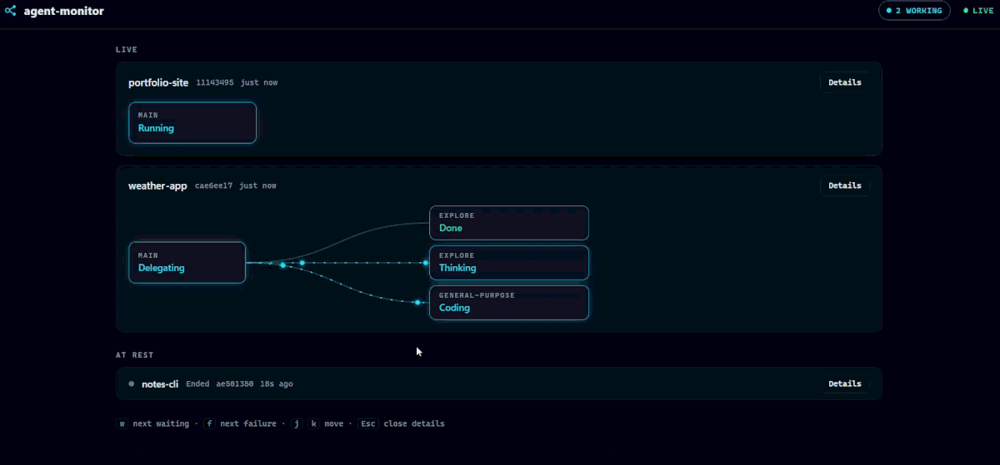
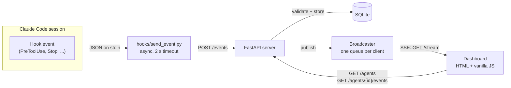

# agent-monitor

[](https://github.com/HugoPello/agent-monitor/actions/workflows/ci.yml)

[](LICENSE)

**A real-time dashboard for your [Claude Code](https://code.claude.com) agents.**
See every session at a glance: what it is doing right now, which subagents
it delegated to, what failed, and when it is waiting for you.



*A session hands work to three subagents. Work streams along each flow while
they run, a failed test run is marked on the subagent that failed, and each
result travels back when it finishes. The data is made up, from
[`scripts/demo.py`](scripts/demo.py).*

## Features

- **A live circuit per session.** The main agent on the left, its subagents
  on the right, and a flow between them. Work streams along a flow while
  the subagent runs; a finished subagent sends a packet back.
- **What each agent is doing, in one word:** `Thinking`, `Researching`,
  `Coding`, `Running`, `Delegating`, `Waiting for you`, `Finished`, `Stale`,
  `Ended`. See [Status and activity](#status-and-activity).
- **Attention first.** Sessions that need you come first, and only
  `Waiting for you` pulses. Chips in the top bar count what is waiting,
  failed, working and finished; click one to jump to it.
- **Failures where they happened.** A failed step is marked on the node that
  failed ("1 failed") and named in the session ("general-purpose: Bash
  failed"). Clicking it opens the timeline at that row.
- **Event timeline** per session, behind *Details*: the command run, the file
  edited, the prompt, Claude's last reply. A side drawer on wide screens, a
  full-screen sheet on phones.
- **Keyboard shortcuts:** `w` next waiting, `f` next failure, `j`/`k` move
  between sessions, `Esc` close the timeline.
- **Dark and light themes**, a mobile layout, and no motion under
  `prefers-reduced-motion`.
- **Live updates** over Server-Sent Events, with automatic catch-up after a
  reconnect.
- **Safe by default:**
  - the hook never slows down or breaks Claude Code;
  - the server listens only on `127.0.0.1`;
  - payloads are rendered as text, never as HTML.
- **Small and dependency-light:** FastAPI + SQLite on the server, plain
  HTML/CSS/JS in the browser, and a hook that uses only the standard library.

## How it works



1. **Hook.** Claude Code runs [`hooks/send_event.py`](hooks/send_event.py) on
   each lifecycle event (session start, prompt, tool use, subagent start/stop,
   notification, stop...). The script forwards the event's JSON to the server
   in the background.
2. **Store.** The server validates the event with Pydantic and stores it in
   SQLite.
3. **Status.** The server works out each session's current status from its
   event history ([`status.py`](src/agent_monitor/status.py)).
4. **Stream.** The new event and the session's updated summary are pushed to
   every open dashboard over Server-Sent Events.
5. **Dashboard.** The page loads the current state once, then applies live
   updates.

## Quick start

Requires **Python 3.12+**.

```bash
git clone https://github.com/HugoPello/agent-monitor.git
cd agent-monitor
python -m venv .venv
.venv\Scripts\activate             # macOS/Linux: source .venv/bin/activate
pip install -e .
python -m agent_monitor            # or: agent-monitor
```

Open **http://127.0.0.1:8765**.

### Try it without Claude Code

In a second terminal, replay three fictional sessions (about 40 seconds):

```bash
python scripts/demo.py             # --speed 2 for faster, --speed 0 for instant
```

To start from an empty dashboard, point the server at a fresh database
first, for example `AGENT_MONITOR_DB_PATH=data/demo.db`.

### Connect Claude Code

The hook is enabled **per project**, only where you want it. Your global
Claude Code configuration is not touched.

1. In the project you want to monitor, create `.claude/settings.local.json`
   with the content of [`hooks/settings.example.json`](hooks/settings.example.json).
2. Replace `/ABSOLUTE/PATH/TO/agent-monitor` with the path to this repository.
   Use forward slashes, also on Windows: Claude Code runs hook commands in
   Git Bash there. Example: `C:/Users/you/agent-monitor`.
3. Make sure `.claude/settings.local.json` is git-ignored in that project.
   Claude Code only does this automatically for files it creates itself.

Start Claude Code in that project and its session appears on the dashboard.
Hooks only run in folders you have accepted in Claude Code's workspace trust
dialog.

To monitor a **single session** instead, pass the file when you start it:

```bash
claude --settings /path/to/your-hooks.json
```

The hook uses only the Python standard library and runs with your system
Python, so it needs no virtualenv. If the monitor is not running, the hook
fails silently in the background and Claude Code is not affected.

## Docker

```bash
docker build -t agent-monitor .
docker run -d --name agent-monitor \
  -p 127.0.0.1:8765:8765 \
  -v agent-monitor-data:/data \
  agent-monitor
```

- **`-p 127.0.0.1:8765:8765`** publishes the port on your machine only.
  Inside the container the server must listen on all interfaces, so this is
  what keeps the monitor private. Event payloads can contain code and
  secrets from tool inputs.
- **`-v agent-monitor-data:/data`** keeps the database in a named volume, so
  it survives when the container is recreated.

The image:

- is built in two stages and installs the project from a wheel;
- runs as an unprivileged user;
- has a health check;
- shuts down cleanly on `docker stop`, even with dashboards connected.

## Configuration

### Server

Set these in the environment or in a `.env` file (copy
[`.env.example`](.env.example)).

| Variable | Default | Purpose |
|---|---|---|
| `AGENT_MONITOR_HOST` | `127.0.0.1` | Interface to listen on |
| `AGENT_MONITOR_PORT` | `8765` | Port for the API and the dashboard |
| `AGENT_MONITOR_DB_PATH` | `data/agent_monitor.db` | SQLite database file |
| `AGENT_MONITOR_STALE_AFTER_SECONDS` | `600` | A working session silent for this long is shown as `Stale` |

### Hook

Set these in the environment of the hook command.

| Variable | Default | Purpose |
|---|---|---|
| `AGENT_MONITOR_URL` | `http://127.0.0.1:8765/events` | Where to send events |
| `AGENT_MONITOR_HOOK_TIMEOUT` | `2` | Seconds before giving up |
| `AGENT_MONITOR_HOOK_LOG` | unset | File to append errors to, for troubleshooting |

## Status and activity

Each session has a **status**, worked out from its events, and an
**activity**, the word the dashboard shows, worked out from the status.

### Status

Each session's status comes from its latest **main-agent** event. Subagent
events don't change it: while a subagent works, the main agent is still
inside its `Agent` tool call.

| Status | Shown when the last relevant event is |
|---|---|
| `idle` | `SessionStart`, `Stop`, or an idle notification |
| `working` | `UserPromptSubmit`, `PostToolUse`, `PostToolUseFailure` |
| `running_tool` | `PreToolUse` (the activity says what kind of tool) |
| `waiting_input` | a permission-prompt notification |
| `ended` | `SessionEnd` |
| `stale` | `working` or `running_tool`, but no event for `STALE_AFTER_SECONDS` |
| `unknown` | no event the monitor knows how to interpret yet |

Subagents are tracked from `SubagentStart` and `SubagentStop`. Session and
subagent events share the same `session_id` and differ only by `agent_id`.

### Activity

Hooks say *which* tool runs, never *why*, so the activity is a heuristic:
it names the kind of tool running. Subagents get an activity the same way,
from their own events.

| Activity | When |
|---|---|
| `Researching` | running `Read`, `Grep`, `Glob`, `WebSearch`, `WebFetch` or `LSP` |
| `Coding` | running `Edit`, `Write` or `NotebookEdit` |
| `Running` | running `Bash` or `PowerShell` |
| `Delegating` | running `Agent` (called `Task` before Claude Code 2.1.63) |
| `Working` | running any other tool, MCP tools included |
| `Thinking` | `working`, with no tool running |
| `Waiting for you` | `waiting_input` |
| `Finished` | `idle`, and the last turn ended with `Stop` |
| `Idle` | `idle` before any prompt (a fresh session) |
| `Stale`, `Ended` | the status of the same name |

The table lives in [`TOOL_ACTIVITY`](src/agent_monitor/status.py); extend it
to classify more tools.

**Failed steps** are `PostToolUseFailure` events in the current turn,
subagents included. They stay visible until the next prompt, even if the
agent recovered, so a failure you didn't see is not lost.

## API

Interactive docs are at **http://127.0.0.1:8765/docs**.

| Method | Path | Description |
|---|---|---|
| `POST` | `/events` | Receive a hook event (body: the hook's JSON input) |
| `GET` | `/agents` | Current state of every session, most recent first |
| `GET` | `/agents/{session_id}/events` | Event timeline of one session |
| `GET` | `/stream` | Live feed of new events ([Server-Sent Events](https://developer.mozilla.org/en-US/docs/Web/API/Server-sent_events)) |
| `GET` | `/health` | Liveness check |

Each `/stream` message is an `agent_event` whose `data` is
`{"event": <stored event>, "agent": <updated session summary>}`:

```bash
curl -N http://127.0.0.1:8765/stream
```

## Design decisions

- **The hook must never hurt the agent.**
  - [`send_event.py`](hooks/send_event.py) runs as an `async` hook and always
    exits 0.
  - Claude Code does not enforce `timeout` on async hooks, so the script's
    own 2-second timeout is what bounds it.
  - It ignores `HTTP_PROXY`, so payloads never leave the machine through a
    proxy.
- **A permissive event model.** Claude Code adds hook events and fields over
  time. [`HookEvent`](src/agent_monitor/models.py) requires only `session_id`
  and `hook_event_name`, keeps unknown fields, and stores the raw payload.
  Very long strings are truncated before storage.
- **Status is a pure function.** [`compute_status`](src/agent_monitor/status.py)
  takes the events and "now" as arguments. It does no I/O and never reads the
  clock itself, so every rule is tested with exact timestamps and no mocks.
- **Sync where it blocks, async where it must.** `sqlite3` is blocking:
  - read endpoints are plain `def`, so FastAPI runs them in a thread pool;
  - `POST /events` is `async def`, because it publishes to `asyncio` queues
    that must be used from the event loop. Its database work runs in the
    thread pool explicitly.
- **Backpressure: slow clients are dropped, not waited for.** Each dashboard
  gets a bounded queue ([`broadcaster.py`](src/agent_monitor/broadcaster.py)).
  A frozen browser tab is disconnected instead of blocking the hooks. When it
  reconnects, it reloads the current state.
- **Clean shutdown with open streams.** uvicorn waits for open responses
  *before* running the app's shutdown hooks, and SSE responses never end.
  [`MonitorServer`](src/agent_monitor/server.py) closes the streams first, so
  Ctrl+C and `docker stop` take about a second instead of hanging.
- **Animations show only what hooks prove.** Hooks report who delegated to
  whom and when each subagent finished, not what data passed between them.
  So the flows show exactly that: a stream while a subagent runs and one
  packet back when it ends. Only changes seen live animate, never a page
  load, and nothing moves under `prefers-reduced-motion`. The design rules
  are in [`DESIGN.md`](DESIGN.md), the product brief in
  [`PRODUCT.md`](PRODUCT.md).
- **XSS-safe rendering.** Prompts and commands are untrusted text. The
  dashboard inserts everything with `textContent`, and a test fails if
  [`app.js`](src/agent_monitor/static/app.js) ever uses an HTML-parsing API.

## Development

```bash
pip install -e ".[dev]"
cp .env.example .env               # optional

ruff check . && ruff format --check .
pytest
```

Every pull request goes through CI ([GitHub Actions](.github/workflows/ci.yml)):

- lint and the test suite on Python 3.12 and 3.14;
- a check that the built wheel ships the dashboard;
- building the Docker image and smoke-testing the running container.

```
src/agent_monitor/
  api.py            FastAPI app: REST endpoints, SSE stream, dashboard
  models.py         Pydantic models for hook events
  storage.py        SQLite event store
  status.py         Session and subagent status (pure functions)
  sse.py            SSE message format and per-client stream
  broadcaster.py    In-memory fan-out to connected clients
  server.py         uvicorn server with clean SSE shutdown
  config.py         Settings from the environment / .env
  static/           Dashboard (HTML, CSS, vanilla JS)
hooks/              Claude Code hook script and example settings
scripts/demo.py     Replays fictional sessions for demos
tests/              pytest suite, including real-server integration tests
```

**Out of scope:**

- authentication and multiple users: it is a local, single-user tool;
- cloud deployment;
- frontend frameworks.

The phase-by-phase history is in [PROJECT_STATUS.md](PROJECT_STATUS.md).

## License

[MIT](LICENSE)
